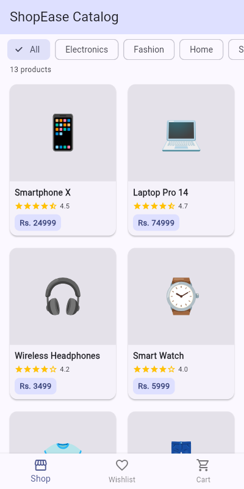
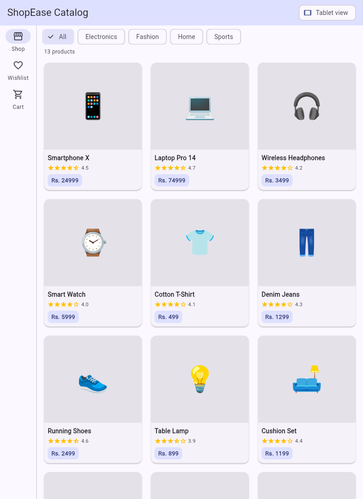
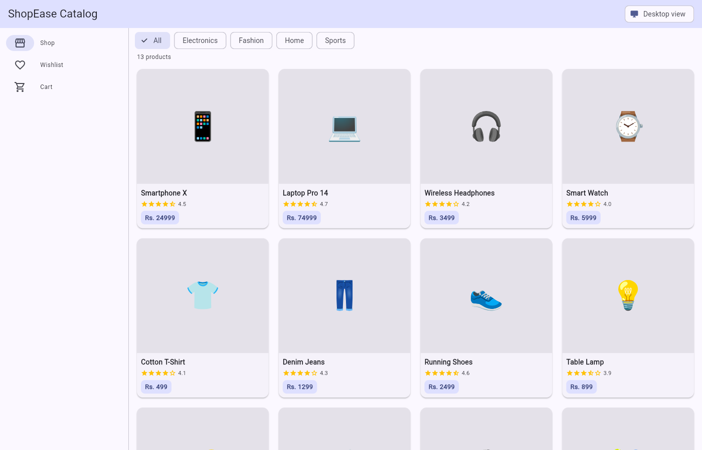

# Experiment 2 – Adaptive and Responsive UI Design

**Course:** 24CS2016 – Building Applications using Flutter  |  **Reg. No.:** URK23CS5014

## Aim
To design and implement a responsive Flutter application for an E-Commerce Product Catalog
using reusable custom product widgets, which adapts to different screen sizes using responsive
layout techniques.

## Features
- Product catalog with 13 products in 4 categories (Electronics, Fashion, Home, Sports)
- Category filter chips, and tapping a product opens a detail screen
- Breakpoints: mobile `< 600`, tablet `600–1024`, desktop `> 1024` (`lib/utils/responsive.dart`)
- `GridView` with 2 / 3 / 4 columns on mobile / tablet / desktop
- Adaptive navigation: `BottomNavigationBar` on mobile, `NavigationRail` on tablet and desktop (extended on desktop)
- Detail screen uses a `Column` on mobile and a `Row` on tablet/desktop
- Uses `MediaQuery`, `LayoutBuilder`, `Flexible`/`Expanded` and `AspectRatio`
- Reusable widgets: `ProductCard`, `ProductGrid`, `CategoryChips`, `PriceTag`, `RatingStars`
- No external packages or network images (emojis and Material icons only)

## Project structure
```
lib/
├── main.dart
├── models/product.dart
├── data/product_data.dart
├── utils/responsive.dart
├── screens/catalog_screen.dart
├── screens/product_detail_screen.dart
└── widgets/
    ├── product_card.dart
    ├── product_grid.dart
    ├── category_chips.dart
    ├── price_tag.dart
    └── rating_stars.dart
```

## How to run
```bash
flutter pub get
flutter run -d chrome   # then resize the browser window to see the layout adapt
flutter test
```

## Screenshots
| Mobile (400×800) | Tablet (800×1100) | Desktop (1400×900) |
|---|---|---|
|  |  |  |
